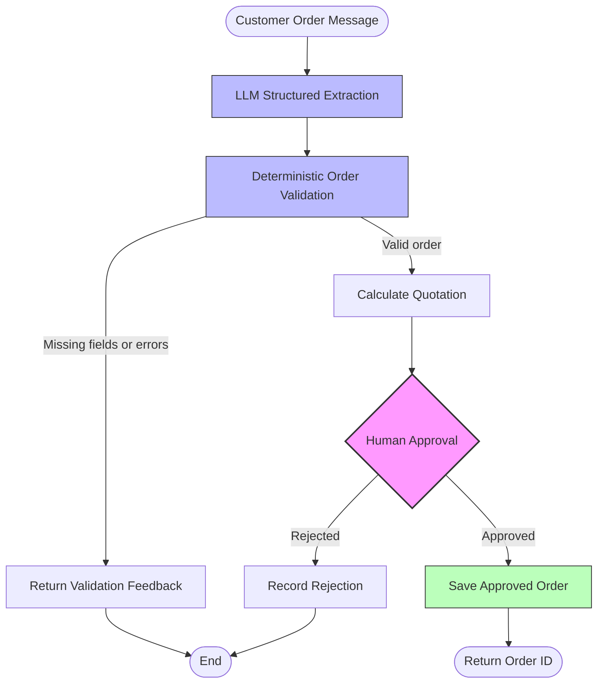
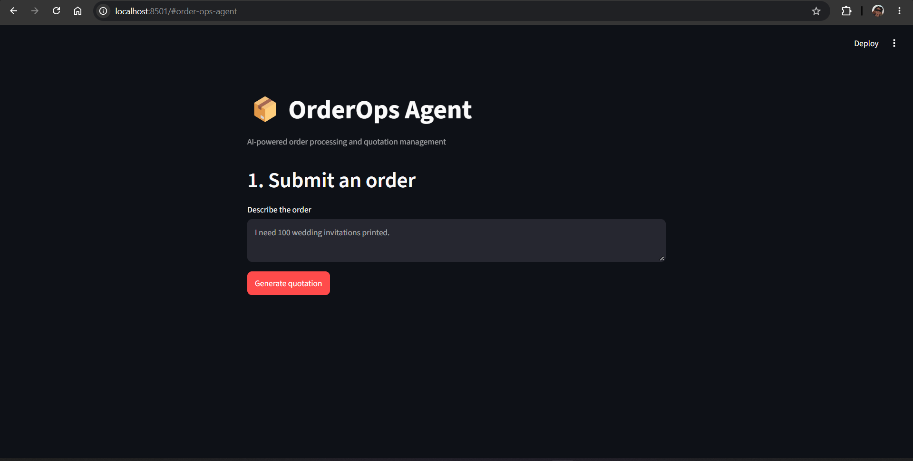
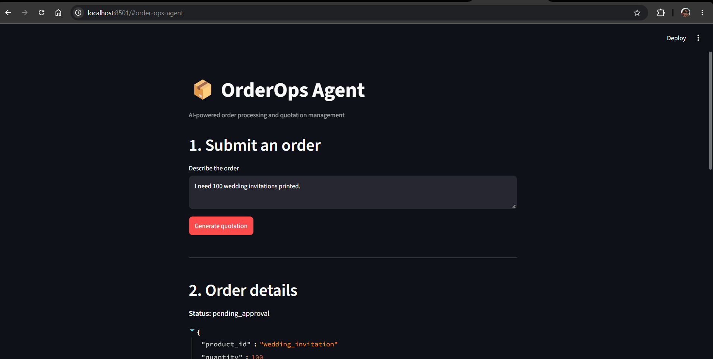
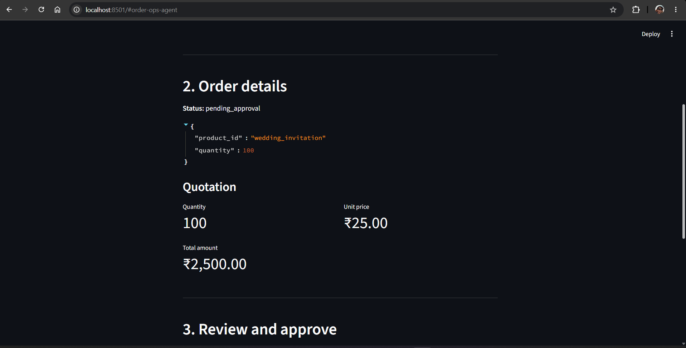
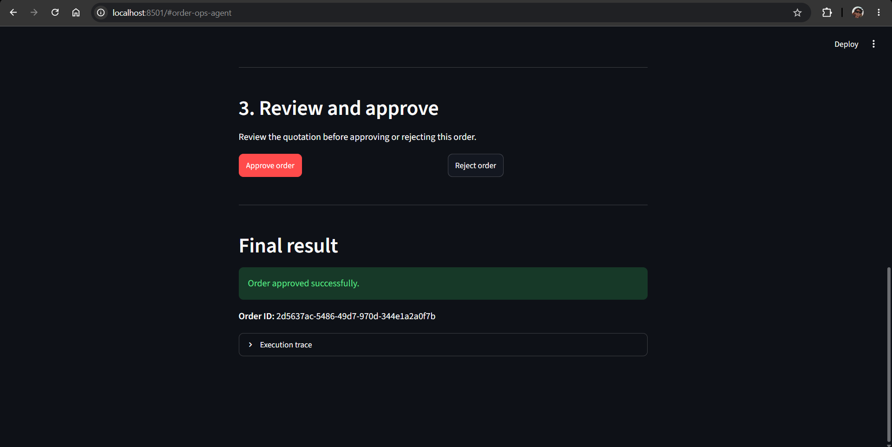
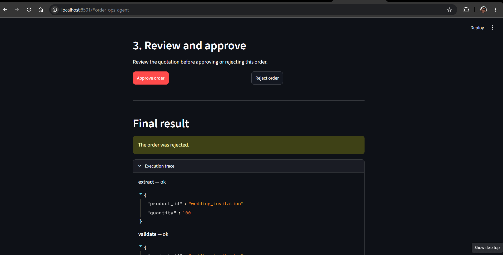
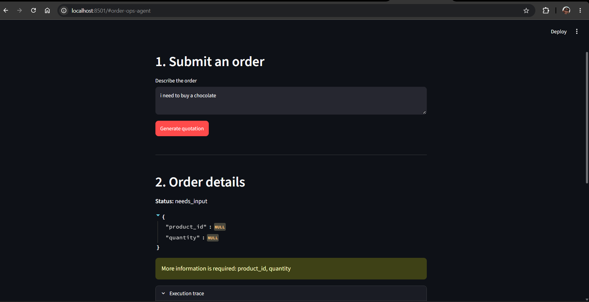
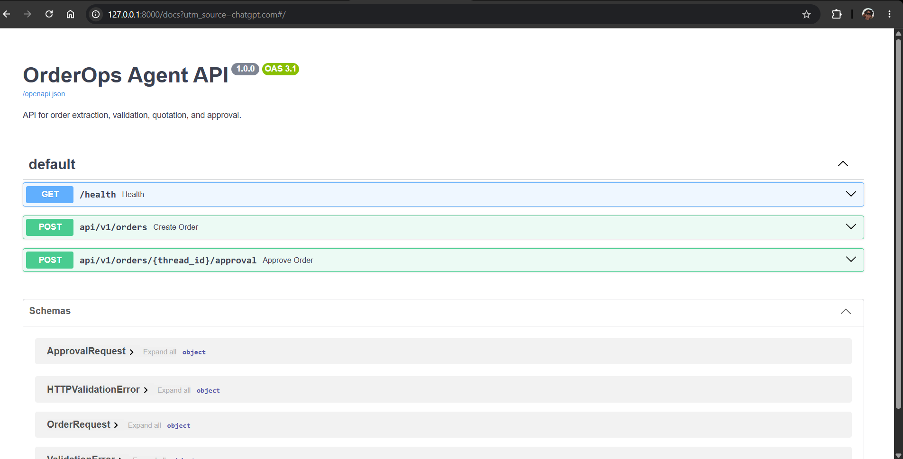

# OrderOps Agent

> An AI-powered business automation agent for order processing. It extracts product and quantity details from natural-language customer requests, validates orders against a product catalogue, generates quotations, and pauses for human approval before saving approved orders.

[](https://www.python.org/downloads/release/python-3120/)
[](https://github.com/langchain-ai/langgraph)
[](https://fastapi.tiangolo.com/)
[](https://streamlit.io/)
[](https://docs.docker.com/compose/)

## The Problem

Small printing businesses often process customer orders manually. Employees must interpret customer messages, identify products and quantities, verify minimum order requirements, calculate prices, and obtain approval before finalizing orders.

This repetitive process can lead to missing information, invalid orders, and inconsistent quotations.

Most AI chatbots simply answer questions. **OrderOps Agent is a workflow automation system** that extracts order information, applies business rules, calculates quotations, and coordinates human approval before finalizing an order.

## Architecture



### Architecture Overview

- **Extraction:** An LLM converts a natural-language customer message into structured order fields using Pydantic.
- **Validation:** Python checks required fields, product IDs, quantity types, positive quantities, and minimum order requirements.
- **Quotation:** Python calculates the subtotal and total using prices from the configured product catalogue.
- **Human-in-the-Loop:** LangGraph pauses execution while the quotation awaits a decision.
- **Persistence:** Approved orders are appended to a local JSON file.
- **API:** FastAPI exposes endpoints for order creation, approval, and health checks.
- **UI:** Streamlit provides an interactive dashboard for order submission, quotation review, and approval.

## Screenshots

### 1. OrderOps Dashboard



The dashboard provides the entry point for submitting customer order requests.

### 2. Order Submission



The user describes the requested order in natural language. The agent extracts the relevant order information.

### 3. Order Details and Quotation



The application displays extracted order details, workflow status, quantity, unit price, and total amount.

### 4. Successful Approval



After approval, the workflow resumes, saves the approved order, and returns a unique order ID.

### 5. Human Rejection



The reviewer can reject the quotation. The workflow records the rejection without adding the rejected order to the approved-orders collection.

### 6. Invalid Order Handling



Missing information or validation errors are returned without proceeding to quotation approval.

### 7. FastAPI Documentation



FastAPI automatically generates interactive Swagger documentation at `/docs`.

## Key Engineering Decisions

### 1. LLM for Extraction, Python for Business Rules

LLMs are useful for interpreting unstructured customer messages, but business rules should be explicit and deterministic.

The LLM extracts structured fields such as product ID and quantity. Python then validates those fields and calculates the quotation using the configured catalogue.

This separation makes important business logic easier to test, explain, and maintain.

### 2. Human-in-the-Loop Approval

The application uses LangGraph's `interrupt()` mechanism to pause the workflow before finalizing an order.

The API returns the quotation and the workflow's `thread_id`. When a reviewer approves or rejects the order, the API resumes the interrupted workflow using `Command(resume=...)` and the same thread ID.

This demonstrates a human-in-the-loop pattern in which an explicit decision is required before an order is finalized.

### 3. Deterministic Validation and Quotation

Product prices and minimum quantities are defined in the local product catalogue.

The validation and quotation nodes use these configured values rather than asking the LLM to determine whether an order is valid or calculate its price.

For example, 100 wedding invitations at ₹25 each produce a total of ₹2,500.

### 4. Separation of Backend and UI

FastAPI exposes the workflow through REST endpoints. Streamlit communicates with the backend over HTTP rather than implementing the business workflow itself.

This separation allows the interface and backend to evolve independently.

### 5. Execution Trace

Each workflow node adds a trace entry containing its name, status, and relevant details.

The trace makes the execution path visible and helps with debugging, understanding workflow decisions, and demonstrating how the agent processes an order.

## Features

- **Structured Extraction** — Converts natural-language order messages into structured product and quantity fields.
- **Catalogue Validation** — Checks product IDs, required fields, quantity types, positive quantities, and minimum order requirements.
- **Quotation Generation** — Calculates unit price, subtotal, and total from configured product data.
- **Human-in-the-Loop** — Pauses for approval or rejection using LangGraph interrupts and resume commands.
- **Order Persistence** — Saves approved orders with generated order IDs.
- **FastAPI Backend** — Provides REST endpoints for order submission, approval, and health checks.
- **Streamlit Dashboard** — Supports order submission, quotation review, approval, rejection, and trace inspection.
- **Execution Trace** — Records the status and details of workflow nodes.
- **Docker Support** — Includes separate backend and UI Dockerfiles with Docker Compose orchestration.

## Technology Stack

| Layer | Technology |
|---|---|
| Language | Python 3.12 |
| LLM integration | LangChain, ChatOpenAI |
| Structured extraction | Pydantic |
| Workflow orchestration | LangGraph |
| Backend | FastAPI, Uvicorn |
| Frontend | Streamlit |
| Data persistence | JSON files |
| Configuration | python-dotenv |
| Code quality | Ruff |
| Testing | pytest |
| Containerization | Docker, Docker Compose |

## Quickstart

### Prerequisites

- Python 3.12 or later
- An OpenAI API key
- Docker and Docker Compose, if using the containerized setup

### Run with Docker Compose

Clone the repository:

```bash
git clone <https://github.com/jaskaranjjk97/order-ops-agent>
cd orders-ops-agent
```

Create your environment file:

```bash
cp .env.example .env
```

Edit `.env` and add your OpenAI API key.

Build and start the services:

```bash
docker compose up --build
```

Open the Streamlit dashboard:

**http://localhost:8501**

FastAPI Swagger documentation is available at:

**http://localhost:8000/docs**

To stop the containers:

```bash
docker compose down
```

### Run Locally

Clone the repository and enter the project directory:

```bash
git clone <YOUR_REPOSITORY_URL>
cd orders-ops-agent
```

Create and activate a virtual environment.

**Windows PowerShell:**

```powershell
python -m venv .venv
.\.venv\Scripts\Activate.ps1
```

Install dependencies:

```powershell
python -m pip install -r requirements.txt
```

Create the environment file:

```powershell
Copy-Item .env.example .env
```

Edit `.env` and add your OpenAI API key.

Start the FastAPI backend:

```powershell
uvicorn app.main:app --reload
```

Keep the backend running. Open a second terminal, activate the same virtual environment, and start Streamlit:

```powershell
streamlit run ui/streamlit_app.py
```

Open the applications:

- **Streamlit dashboard:** http://localhost:8501
- **FastAPI Swagger UI:** http://localhost:8000/docs
- **API health check:** http://localhost:8000/health

## Environment Variables

Configure these variables in your local `.env` file:

```env
OPENAI_API_KEY=your_openai_api_key
OPENAI_MODEL=gpt-5-mini
```

The model value matches the default configured by the application. Change it if your configuration uses another supported model.

Never commit your actual `.env` file or expose your API key.

## API Endpoints

| Method | Endpoint | Purpose |
|---|---|---|
| GET | `/health` | Check API availability |
| POST | `/api/v1/orders` | Submit and process an order |
| POST | `/api/v1/orders/{thread_id}/approval` | Approve or reject a pending order |

### Example: Create an Order

Request:

```json
{
  "customer_message": "I need 100 wedding invitations printed."
}
```

Example response:

```json
{
  "status": "pending_approval",
  "thread_id": "<generated-thread-id>",
  "order_details": {
    "product_id": "wedding_invitation",
    "quantity": 100
  },
  "quote": {
    "product_id": "wedding_invitation",
    "product_name": "Wedding Invitation",
    "quantity": 100,
    "unit_price": 25.0,
    "subtotal": 2500.0,
    "total": 2500.0,
    "currency": "INR"
  },
  "trace": []
}
```

The actual response contains a generated thread ID and trace entries for the completed workflow nodes.

### Example: Approve an Order

Use the actual `thread_id` returned by the order-creation endpoint.

Request body:

```json
{
  "approved": true
}
```

To reject the order, send:

```json
{
  "approved": false
}
```

An approved order returns a generated order ID. A rejected order returns a rejected status without an approved order ID.

## Example Workflow

1. **Customer request:** A customer submits, "I need 100 wedding invitations printed."
2. **Extraction:** The LLM identifies the product ID and quantity.
3. **Validation:** Python validates the extracted fields against the product catalogue.
4. **Quotation:** The application calculates 100 × ₹25 = ₹2,500.
5. **Workflow interruption:** LangGraph pauses execution and returns the quotation for review.
6. **Human decision:** The reviewer approves or rejects the order.
7. **Workflow resumption:** The API resumes the interrupted workflow using the same thread ID.
8. **Final result:** If approved, the order is saved and a unique order ID is returned. If rejected, the workflow records the rejection.

## Project Structure

```text
orders-ops-agent/
├── app/
│   ├── __init__.py
│   ├── config.py
│   ├── llm.py
│   ├── state.py
│   ├── graph.py
│   ├── main.py
│   └── nodes/
│       ├── __init__.py
│       ├── extract.py
│       ├── validate.py
│       ├── quote.py
│       └── approve.py
├── data/
│   ├── products.json
│   └── orders.json
├── docs/
│   ├── 01-landing.png
│   ├── 02-order-input.png
│   ├── 03-order-status.png
│   ├── 04-approved.png
│   ├── 05-rejected.png
│   ├── 06-invalid-order.png
│   └── 07-swagger.png
├── scripts/
│   └── run_graph.py
├── tests/
│   ├── test_setup.py
│   └── test_workflow.py
├── ui/
│   └── streamlit_app.py
├── .env.example
├── .gitignore
├── .dockerignore
├── Dockerfile
├── Dockerfile.ui
├── docker-compose.yml
├── pyproject.toml
├── requirements.txt
└── README.md
```

## Testing and Code Quality

Run Ruff to check the code:

```bash
ruff check .
```

Format the code:

```bash
ruff format .
```

Run the check again:

```bash
ruff check .
```

Run the test suite:

```bash
python -m pytest -q
```

The current test suite includes a configuration smoke test. Additional targeted tests for API behavior and approval/rejection can improve coverage without requiring a large test suite.

## Limitations and Future Improvements

- **In-memory checkpoints:** `InMemorySaver` loses pending workflow state when the API process restarts. Persistent checkpoint storage, such as SQLite or PostgreSQL, would be more appropriate for a production deployment.
- **Local JSON persistence:** Orders are stored in a local JSON file. A database would be more suitable for concurrent users and production workloads.
- **No authentication:** The API and UI do not currently implement user authentication or authorization.
- **Limited catalogue:** Product information, prices, and minimum quantities come from a small local catalogue.
- **No production hardening:** Logging, monitoring, access controls, persistence guarantees, and deployment security would need further work.

